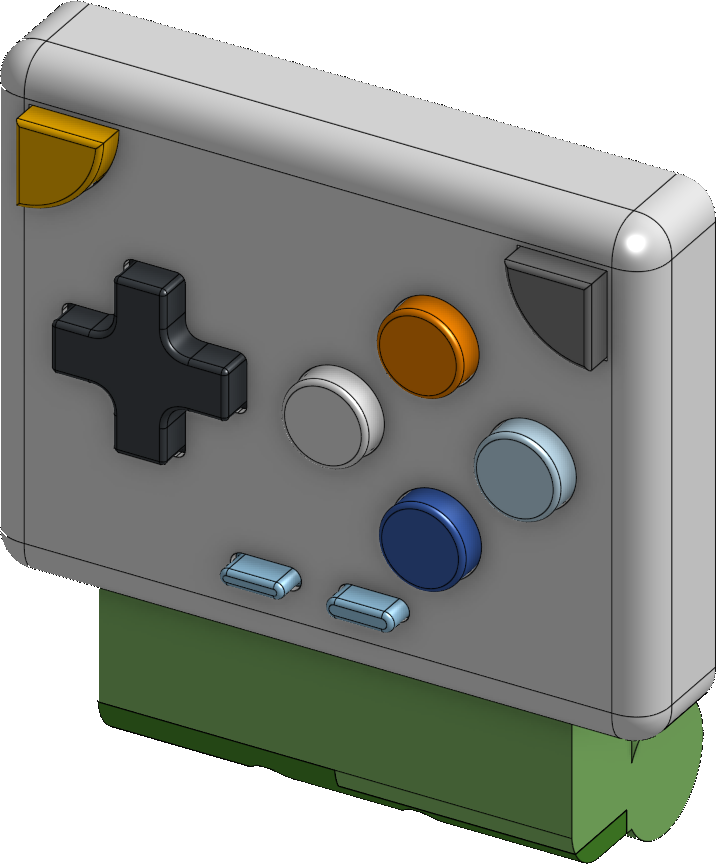
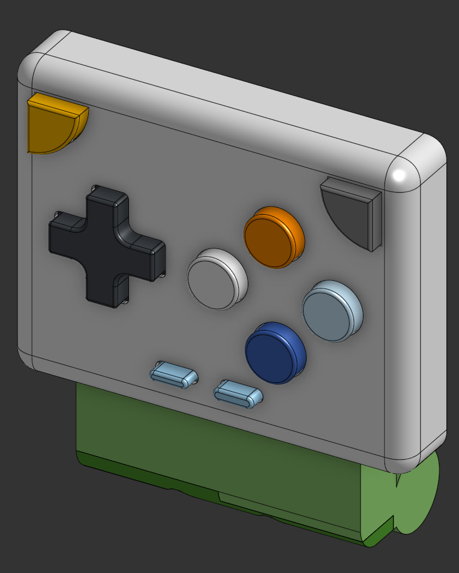
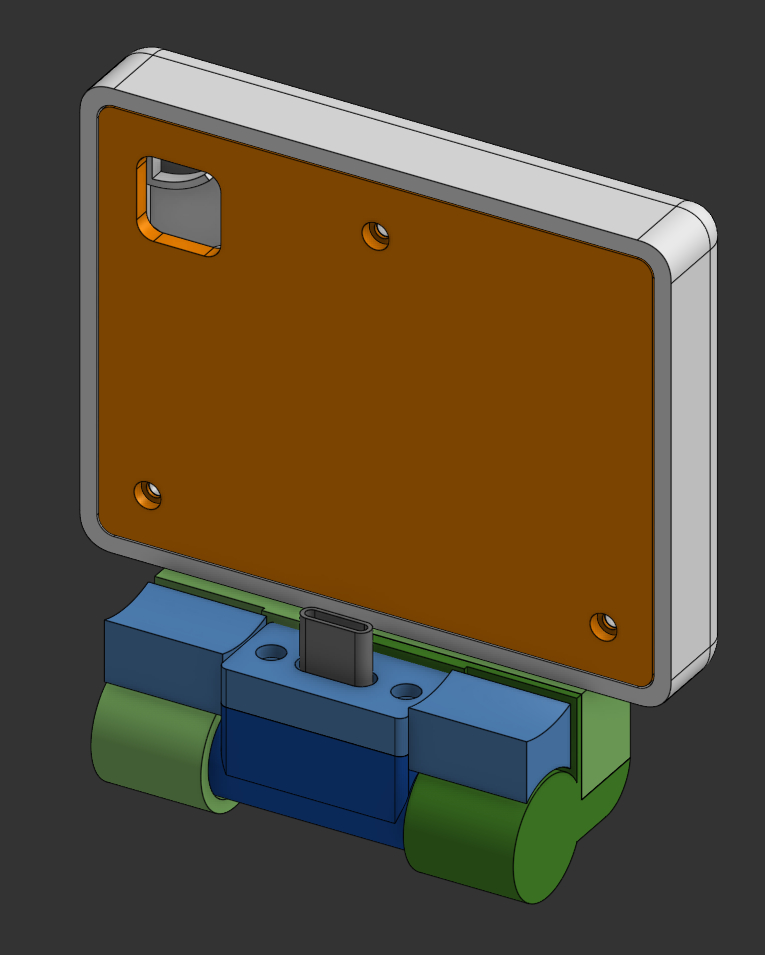
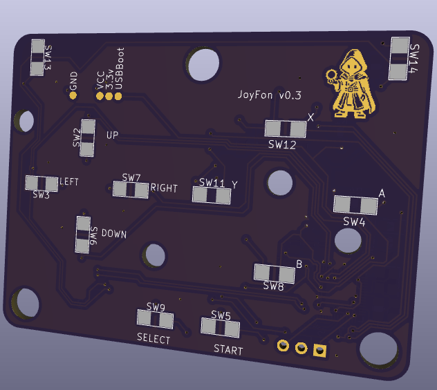
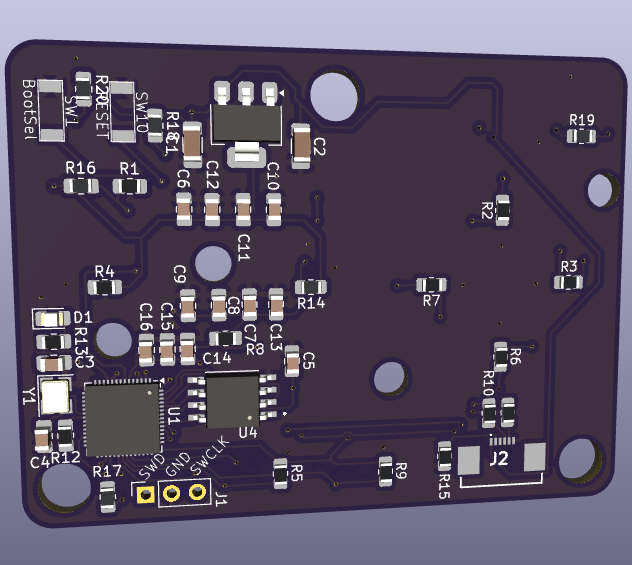

<p align="center">
  
</p>

# Joyfon

A USB HID game controller for the Raspberry Pi Pico (RP2040 / RP2350).

Joyfon enumerates as a **standard USB HID gamepad**, so phones (Android), PCs,
and emulators recognize it with no driver or app. The button layout mimics a
Game Boy Color: a 4-way D-pad plus `A`, `B`, `X`, `Y`, shoulder buttons
(`SR`/`SL`), and `START` / `SELECT`.

## Enclosure & PCB

The 3D-printable enclosure is modeled in Onshape:
[Joyfon case (Onshape)](https://cad.onshape.com/documents/5b058211584da6ba94a5f3a2/w/7946df008143afeea2af8019/e/bb1aadbdb91d94f271c1447f?page=2&email=giliy%40nyxsecurity.net&renderMode=0&uiState=6a5551800e11d12ad61d855e).

| Case front | Case back |
| ---------- | --------- |
|  |  |

| PCB front | PCB back |
| --------- | -------- |
|  |  |

## Wiring

All buttons are **active-low**: wire each button between its GPIO and `GND`.
The firmware enables the RP2040's internal pull-ups, so external pull-up
resistors are optional (the description below assumes you already have them).

| Function        | GPIO  |
| --------------- | ----- |
| D-pad DOWN      | 0     |
| D-pad RIGHT     | 1     |
| D-pad UP        | 2     |
| D-pad LEFT      | 3     |
| B               | 4     |
| A               | 5     |
| X               | 20    |
| Y               | 21    |
| SR (R shoulder) | 22    |
| SL (L shoulder) | 25    |
| START           | 23    |
| SELECT          | 24    |
| Status LED      | 8     |

The status LED (GPIO8, active-high through a current-limiting resistor):

- **Blinks @ 250 ms** — USB not mounted (waiting for host).
- **Blinks @ 1 s** — USB suspended.
- **Solid while pressed** — mounted and running; lights up whenever any button
  is held, as live input feedback.

## HID mapping

The gamepad report is the TinyUSB standard gamepad (`hid_gamepad_report_t`):

| Physical button | HID control                        |
| --------------- | ---------------------------------- |
| D-pad           | Hat switch (8 directions)          |
| A               | Button 1 (`GAMEPAD_BUTTON_A`)      |
| B               | Button 2 (`GAMEPAD_BUTTON_B`)      |
| X               | Button 4 (`GAMEPAD_BUTTON_X`)      |
| Y               | Button 5 (`GAMEPAD_BUTTON_Y`)      |
| SR (R shoulder) | Button 8 (`GAMEPAD_BUTTON_TR`)     |
| SL (L shoulder) | Button 7 (`GAMEPAD_BUTTON_TL`)     |
| START           | Button 12 (`GAMEPAD_BUTTON_START`) |
| SELECT          | Button 11 (`GAMEPAD_BUTTON_SELECT`)|

Opposing D-pad directions cancel out (e.g. pressing UP and DOWN together
reports centered) so no impossible diagonal is ever sent. Reports are only sent
when the button state changes, keeping latency low and the bus quiet.

## Building

This project expects the [pico-sdk](https://github.com/raspberrypi/pico-sdk).
By default `CMakeLists.txt` looks for it at `../pico-sdk` (a sibling of this
folder). You can override that with the `PICO_SDK_PATH` environment variable.

Prerequisites: `cmake` (>= 3.13), the `arm-none-eabi` GCC toolchain, and the
SDK submodules (TinyUSB) initialized.

```bash
# from the joyfon/ directory
mkdir build && cd build
cmake ..                    # or: cmake -DPICO_SDK_PATH=/path/to/pico-sdk ..
make -j
```

To target a different board (e.g. a Pico 2 / RP2350), pass the board at
configure time:

```bash
cmake -DPICO_BOARD=pico2 ..
```

The build produces `build/joyfon.uf2`.

## Flashing

1. Hold the **BOOTSEL** button while plugging the Pico into USB; it mounts as a
   mass-storage drive (`RPI-RP2`).
2. Copy `joyfon.uf2` onto it. The Pico reboots and re-enumerates as the
   "Joyfon Game Controller" gamepad.

After flashing, plug the Pico into a phone (via USB-OTG / USB-C). It should
appear as a connected gamepad, ready for use with emulators or any app that
supports HID controllers.

## Notes

- Uses the test VID `0xCafe` / PID `0x4007`. Use a VID/PID you own before
  distributing hardware.
- The RP2040 USB enumeration errata fix (RP2040-E5) is enabled in
  `CMakeLists.txt`; it reserves GPIO15 internally on RP2040 boards.
